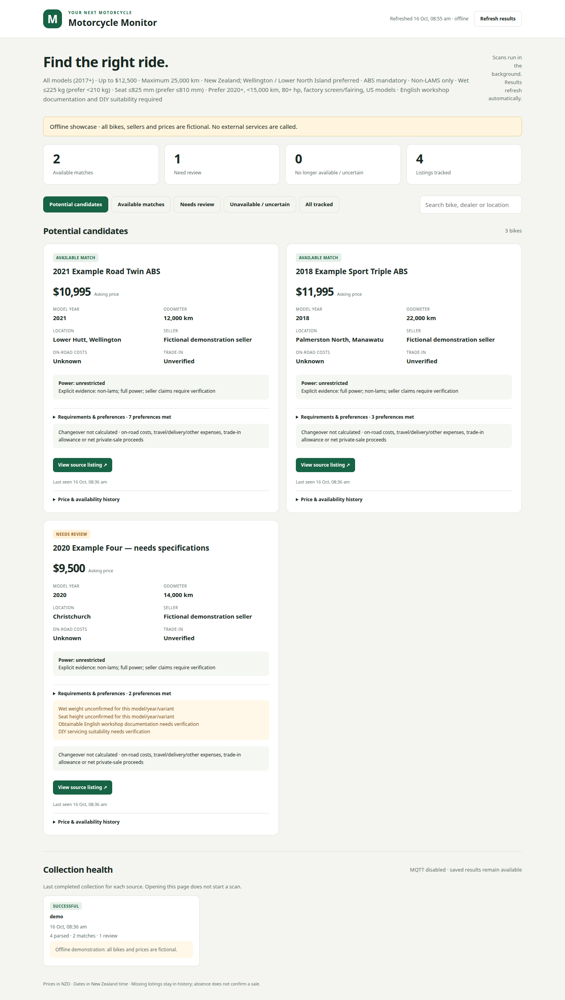

# Motorcycle Monitor

A Python 3.11+ service for personal motorcycle purchasing research in New Zealand.
It monitors public Trade Me and dealer stock, preserves SQLite history and queues
MQTT alerts. It runs in a Python virtualenv on an Ubuntu/Debian Proxmox LXC.

The current `config.bike-search.yaml` searches all models: up to NZ$12,500,
2017+, at most 25,000 km, twin/triple/four-cylinder, ABS, non-LAMS, wet weight at
most 225 kg and seat height at most 825 mm. English workshop documentation and
DIY servicing suitability require evidence. Preferences rank candidates: 2020+,
under 15,000 km, at least 80 hp, **strictly under 210 kg wet**, seat at most 810 mm,
factory screen/fairing, US-market models and Wellington/Lower North Island.
Unknown mandatory facts go to review; auction bids never establish purchase price.

## Try the offline showcase

```bash
python3 -m venv .venv
.venv/bin/python -m pip install -e '.[dev]'
.venv/bin/python scripts/demo.py
```

Open **http://127.0.0.1:8765/**. The demo uses isolated, fictional inventory and
calls no external services. Stop it with Ctrl+C. No broker, API keys, browser
installation or live dealer access is needed.



## Design and scope

Eight independent dealer sites and two marketplaces feed a read-only dashboard.
Collection is paced and bounded; failures stay visible, history survives restarts,
and partial discovery never marks unseen bikes unavailable. A transactional MQTT
outbox supports delivery retries. Optional DeepSeek guidance helps research
uncertain candidates without overriding deterministic rules. Optional Brave or
Tavily indexed search needs its own provider key; direct dealer browsing does not.

The code separates domain rules, application orchestration, acquisition adapters,
persistence and presentation, with small injectable ports for external services.
See [architecture and decisions](docs/ARCHITECTURE.md),
[search policy and coverage](docs/SEARCH.md), [security](SECURITY.md) and
[verification](docs/VERIFICATION.md). GitHub Actions checks Python 3.11–3.13,
format/lint, offline tests, demo generation and the exact staged files for secrets.

## Update the deployed monitor

Run `./scripts/redeploy.sh` on your desktop, or use **Ctrl+Shift+B** in VS Code.
The saved preset is applied, the dashboard restarts, and a fresh scan runs.
To switch an older installation to the broader search, run:

```bash
./scripts/redeploy.sh --preset config.bike-search.yaml
```

Edit `config.bike-search.yaml` for future changes. The broad preset replaces the
previous model-specific source URLs, while preserving database, valuations,
broker and web settings. Earlier Ninja-specific presets remain available.
See [deployment](docs/DEPLOYMENT.md#one-command-updates-from-your-desktop) and
[search requirements and AI review](docs/SEARCH.md).

## Local installation

```bash
python3 -m venv .venv
.venv/bin/pip install -e '.[test,browser]'
.venv/bin/playwright install chromium
cp config.example.yaml config.yaml
.venv/bin/motorcycle-monitor validate-config
.venv/bin/pytest -q
.venv/bin/motorcycle-monitor scan --dry-run
```

On a minimal Ubuntu LXC, install `python3-venv` and Playwright's Linux browser
libraries using `.venv/bin/playwright install-deps chromium` as root. Use
`collector.browser_executable: /usr/bin/chromium` if a working system Chromium is
already installed. Do not install Python packages into Ubuntu's system Python.
For dealer-only HTTP operation install `.[test]` and disable the Trade Me source
and browser fallback; Chromium is then unnecessary.

Trade Me search URLs were discovered using the site's public search controls.
Both dealer parsers use inspected actual HTML; TSS collection follows verified
public filter pagination across new and used stock. See [acquisition evidence and
limits](docs/ACQUISITION.md). Searches can change, so parser failures are visible
and do not erase listings. Broad Trade Me discovery uses bounded rotating pages and explicitly reports partial
coverage; it never infers unavailability from those partial scans. Narrow searches
still require complete results.

## Desktop dashboard

Open `http://LXC_IP:8765/` from your desktop after enabling the supplied
`motorcycle-monitor-web.service` inside the LXC. It shows readable bike cards,
review reasons, availability, links, history and collection health. Results
refresh automatically while the scan timer continues in the background.
See [dashboard deployment](docs/DEPLOYMENT.md#desktop-web-dashboard) for the copy,
installation and systemd commands. Existing database/history are reused.

For local development, run `.venv/bin/motorcycle-monitor serve --host 127.0.0.1`
and open `http://127.0.0.1:8765/` on the same machine.

## Commands

The global `--config FILE` option precedes the command.

```bash
.venv/bin/motorcycle-monitor scan
.venv/bin/motorcycle-monitor scan --dry-run
.venv/bin/motorcycle-monitor scan --notify-initial
.venv/bin/motorcycle-monitor status
.venv/bin/motorcycle-monitor listings
.venv/bin/motorcycle-monitor listings --review
.venv/bin/motorcycle-monitor history trademe:5915854398
.venv/bin/motorcycle-monitor test-mqtt
.venv/bin/motorcycle-monitor publish-pending
```

Dry-run neither writes the live database/log/cache/lock nor publishes. Browser
rendering may create temporary browser process files, but no persistent profile
or service data. First successful collections in a scan share one baseline
summary, rather than individual listing alerts; `--notify-initial` overrides it.
A confirmed price decrease must exceed the smaller of NZ$500 and 5%, measured
from the last queued alert price (or baseline). Unchanged bikes do not alert.
Missing bikes remain in history and show as no longer seen available after two
complete successful scans at least twelve hours apart. Failed scans reset the
absence streak; changed search scope resets it too. Partial imports and dry-runs
cannot imply disappearance. Absence is UNKNOWN, not a confirmed sale; an active
record on another source keeps the bike available. Returning bikes reactivate.

MQTT is disabled in the example until you configure your broker. Events queue
transactionally whether MQTT is enabled or unavailable. Consumers deduplicate
stable event IDs. See [MQTT/Node-RED setup](docs/MQTT.md).

Saved results are readable with `listings`, including direct links, availability
and review reasons. Use `listings --all` to include rejected bikes or
`listings --json` for JSON. The timer performs background scans; the oneshot
service normally exits between runs. See the deployment guide for availability
tracking and timer checks.

## Manual input and trade-in comparison

```bash
.venv/bin/motorcycle-monitor scan --dry-run --import-file tests/fixtures/manual.json
```

That file is **synthetic**, demonstrating the schema only. Copy its shape for
real observations with real original direct URLs. The source and every URL must
match configured host allowlists. Partial manual imports baseline only the
sources explicitly present. Import uses the same filtering/history/outbox rules.
Use `evidence.power` with `status`, `source_url`, `verified_at`, and `quotation`
for externally verified variants; unsupported power_status alone cannot approve.
Record `verified_identity` only after verifying two ads refer to the same bike.
All source URLs remain attached. Structured-data `sameAs` references can identify
a shared exact source URL; their hosts must also be configured. Uncertain matches appear in `status` as duplicate
candidates and remain separate until verified.

The buyer's existing bike is a 2025 Suzuki V-Strom 250SX. Values are manual inputs:

```bash
.venv/bin/motorcycle-monitor add-valuation trade_in 4000 \
  --seller 'TSS Motorcycles' --basis ACTUAL_QUOTE --date 2026-10-13 \
  --provenance 'Written dealer quotation' --expiry 2026-10-20
.venv/bin/motorcycle-monitor add-valuation private_sale 4500 \
  --seller 'Owner estimate' --basis ESTIMATE --date 2026-10-13 \
  --provenance 'Expected net proceeds after sale expenses'
.venv/bin/motorcycle-monitor changeover SOURCE:LISTING_ID \
  --kind trade_in --valuation-id 1 --expenses-nzd 200
```

Examples are not valuations of your bike. ORC and expenses must be explicitly
known before a total is shown. A dealer quote applies only to that dealer and a
verified trade-in opportunity. Quotes and estimates stay separate, dated and
source-backed. Listings rank by complete changeover cost when every offer in the classification
group has a complete scenario, otherwise by fixed asking price. Local/preferred
dealers break financial ties; convenience never overrides eligibility or a
better financial result. CLI output identifies its ranking basis.

`model-support` displays cached research for both generations. Seeds verify US
model/parts sources while clearly marking unknown private-owner manual supply,
aftermarket inventory, diagnostics, compatibility and landed costs. Replace or
expand a memo using `model-support --import-file FILE` with JSON keyed by model,
including `memo`, `sources` and `last_checked`. No research runs on routine scans.
The optional ambiguity-review protocol is present; an LLM implementation is not
included and configuration rejects enabling it.

## Ubuntu LXC deployment and upgrading

See [deployment instructions](docs/DEPLOYMENT.md). The supplied systemd oneshot
calls `/opt/motorcycle-monitor/.venv/bin/motorcycle-monitor`; the timer runs at
08:00 Pacific/Auckland, including daylight saving transitions. Deployment does
not require Docker. No service was installed or enabled on this development host.

## Verification and troubleshooting

Offline pytest covers actual pared-down page excerpts and synthetic edge cases:
power negation/conflicts, models, price/year/km limits, auctions, baseline/new/drop
alerts, price anchors, relisting review, cross-source identities, history/restart,
transactional outbox retries, HTTP blocks, malformed pages, pacing/cache, URLs,
configuration, locking, changeover arithmetic and dry-run guarantees.

A source succeeds with zero results only with an explicit recognized zero count.
Unsupported pages are errors, not empty inventories. Check `status` and logs for
source outcomes, URLs checked and pending notifications. Two consecutive errors
queue one SYSTEM_ERROR per episode; a successful collection resets the episode.
Pending MQTT deliveries remain retryable. Repeated scan failures never imply sale.

Before changing parser/schema code, save minimal offline factual fixtures and
run tests. Database migrations apply automatically with WAL and foreign keys.
Back up using SQLite's backup API or `sqlite3 DB '.backup backup.db'`; do not copy
only the database file while live WAL writes are happening. Software rejects a
database schema version newer than it knows. Follow the full project specification
in [the original document](trademe_motorcycle_monitor_spec.md).

To include a chosen valuation in future alerts, configure an explicit scenario:

```yaml
changeover:
  scenarios:
    'dealer:TSS Motorcycles':
      kind: trade_in
      valuation_id: 1
      expenses_nzd: 200
    private:
      kind: private_sale
      valuation_id: 1
      expenses_nzd: 200
```

The values above are examples. IDs refer to your manually recorded entries;
unknown ORC, unverified trade-in availability or an expired/different-dealer quote
still prevents a total. Existing queued alerts preserve their original assumptions.

A regional Ninja-only preset is supplied in `config.wellington-ninja.yaml`:
full power, all years/prices, strictly under 10,000 km, Wellington through
Palmerston North and the Wairarapa through Masterton. See the deployment guide
for applying only its search settings while preserving your installed broker,
database and web configuration. Saved dashboard results are reevaluated against
current requirements; original observations stay in history.
