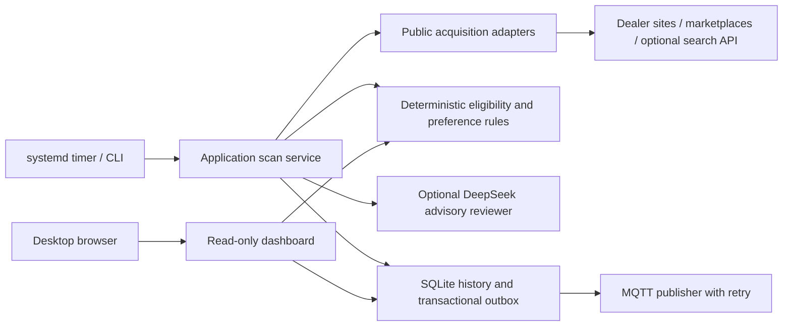

# Architecture

The monitor is a small layered application, deployed as a Python package in a
virtualenv. A scheduled scan and a separate read-only dashboard share SQLite.
The layers are logical Python modules rather than separate network services:
there is no distributed state or framework required for this workload.

## Responsibilities and dependencies

| Layer | Modules | Responsibility |
| --- | --- | --- |
| Domain | `schema`, `normalization`, `classification`, `filtering`, `suitability`, `trade_in` | Evidence, eligibility, preferences and monetary calculations; no network or database calls |
| Application | `service`, `scheduler`, `ports` | Scan lifecycle, locks, sequencing, resource ownership and injected adapter contracts |
| Acquisition adapters | `collectors`, `parsers`, `dealers`, `browser`, `web_discovery`, `search` | Public HTTP/browser access and source-specific interpretation |
| Advisory adapter | `reviewer`, `secrets` | Bounded DeepSeek requests, validation, caching and isolated credential loading |
| Persistence/delivery | `storage`, `notifications` | Versioned SQLite storage, observations, source availability and MQTT outbox |
| Presentation | `cli`, `presentation`, `web`, `web_assets` | Human-readable CLI and read-only LAN UI; no scan-triggering endpoints |
| Operations | `scripts`, `deploy` | Packaging, backups, virtualenv install, systemd, rescan and verification |

`PageFetcher` and `CandidateReviewer` are narrow application ports. Tests inject
mock adapters rather than performing production HTTP or paid API calls. Domain
code never depends on a concrete HTTP client or persistence implementation.
Adapters may use domain rules to prioritize scarce detail-fetching work; the
application always reevaluates the final collected facts before storing them.

The original named-model search and the broader requirements search use separate
policy functions behind `classify`. This preserves the established policy while
making the new requirements independently testable. `current_criteria` evaluates
saved facts against current settings without rewriting observations. Database
records retain the evidence collected at each point in time.

## Decisions and tradeoffs

**Deterministic rules own acceptance.** Required limits and preference thresholds
are explicit configuration. Missing mandatory facts require review. AI text and
memory-based specifications never establish an eligible bike. Seller claims and
independent verification are distinct. This avoids turning an eloquent but
unsupported AI assessment into a factual match.

**Broad discovery is partial.** Independent inventories and indexed searches
cannot promise a complete national baseline. Their source configuration declares
partial coverage, which disables absence-based unavailability transitions. Narrow
complete collections retain the existing spaced-miss logic. Ended adverts and
unknown availability remain visible in history. Broad search pages rotate so
later pages are not permanently starved by the first page.

**Bound external work.** HTTP is serial with pacing, a scan-wide request budget,
per-source page/detail limits and a systemd deadline. Challenged or rate-limited
hosts are suppressed for the rest of that scan, while other sources continue.
Normal app-shell rendering is supported; challenge pages are not treated as empty
results. Optional Brave/Tavily adapters provide indexed search when configured.
Direct dealer collection works without a search-service credential.

**Keep cloud review optional and advisory.** DeepSeek is called directly through
a small HTTP adapter. No OpenClaw deployment is needed. Reviews have a per-scan
call limit, bounded payloads, a timeout, strict response/quotation validation and
content/criteria/model-version caching. A failed review does not erase a listing
or stop deterministic collection. It cannot execute commands, browse arbitrary
URLs or change eligibility.

**Use SQLite and a transactional outbox.** A single writer/scan lock and WAL
support consistent snapshots while the dashboard reads. Listing changes and
notification events are committed together; MQTT delivery retries stable event
IDs. Exact verified identities, rather than similar model/year/price, govern
cross-source merges. This keeps duplicate-looking adverts separate until there
is evidence they describe the same machine.

**Separate deployment from persistent data.** Source artifacts exclude credentials
and runtime files. Deployment backs up SQLite/configuration, installs from clean
staging into the virtualenv, restarts services, rescans and verifies the deployed
revision. Installation failures attempt application/configuration rollback; good
live observation history is not overwritten. The desktop GitHub credential and
LXC DeepSeek credential have separate destinations even when stored together
locally. See [security](../SECURITY.md).

**Avoid unnecessary infrastructure.** A stdlib WSGI server is sufficient for this
trusted-LAN, read-only dashboard. A broker, browser and LLM are optional adapters.
The dashboard has no authentication and is not a public hosted multi-user service;
add an authenticated reverse proxy before exposing it beyond a trusted network.

## Showcase and verification

`python scripts/demo.py` creates an isolated temporary database of fictional
bikes and runs the dashboard on localhost. It requires no API keys, MQTT broker,
Chromium or live listing sites. CI covers supported Python versions, lint/format,
offline tests, the publication guard and demo creation. Browser QA uses the same
fictional dataset, so the README screenshot contains no live seller or owner data.
See [verification](VERIFICATION.md) for what was actually checked.
